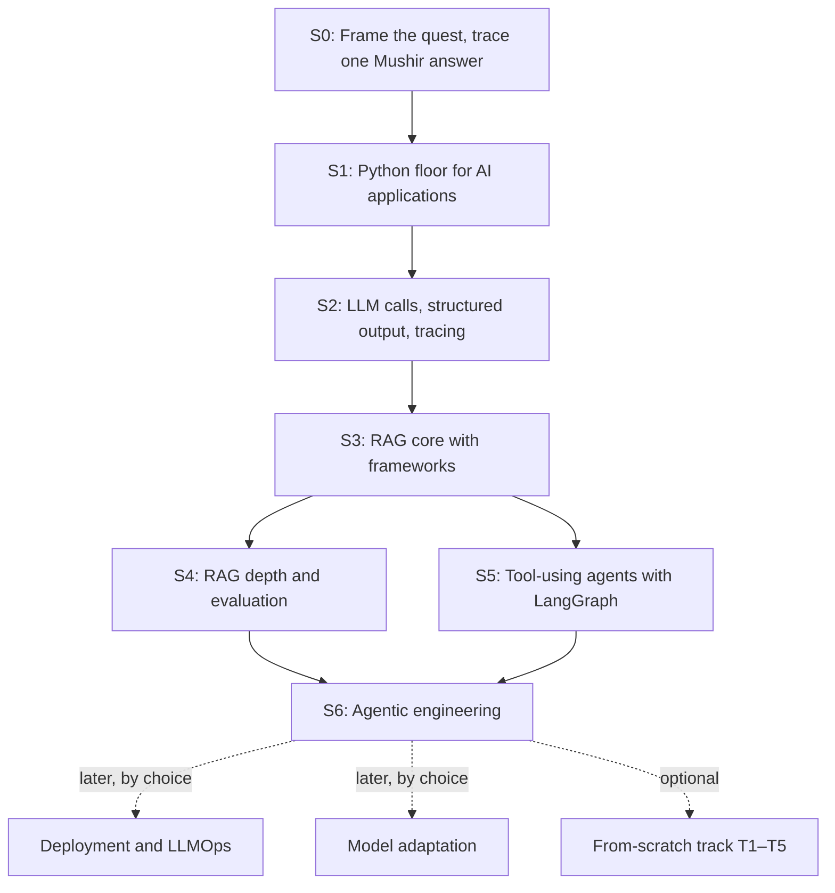

# Ahmed's project route: RAG and agents, with a Python floor

Prepared 11 October 2026; revised 15 October 2026 to put RAG systems and AI agents first. No learner completion is awarded by planning or consolidation.

## The recommendation

Build one **AI Engineering Workbench** that grows a grounded assistant from a typed, tested Python program into evaluated RAG and then tool-using agents. Learn each mechanism with the theory it needs and an existing library or framework. Apply every stage to **Mushir**, the Islamic-finance RAG assistant you are responsible for, so learning and real work reinforce each other.

Your clarifications govern this plan:

- Study **two hours a day, five days a week: 10 hours/week**, CPU first on both machines.
- **Depth:** RAG systems, then AI agents and agentic engineering.
- **Floor:** Python, evaluation, observability, cost, security and delivery, inside every stage.
- **Learn as needed, as much as needed:** enough theory to use a mechanism correctly, then practice with existing frameworks. Plain-Python reimplementation and model internals wait in an optional from-scratch track.
- **Deferred:** deployment/LLMOps and model adaptation come after the core route.
- **Frameworks that matter for jobs** (LangChain, LangGraph, LangSmith, LlamaIndex) are core, alongside the libraries Mushir is built on.
- You write the learning code. The tutor explains, demonstrates small separate examples, reviews attempts and adjusts difficulty.

## Read the planning package

| Document | Purpose |
|---|---|
| [Learning method](01-LEARNING-METHOD.md) | Session structure, hints, concept checks, review and tutor conduct |
| [Project roadmap](02-PROJECT-ROADMAP.md) | Seven stages, exit gates, later branches and the optional track |
| [Skills and mastery](03-SKILLS-AND-MASTERY.md) | Diagnostic, capability coverage and mastery evidence |
| [First four weeks](04-FIRST-FOUR-WEEKS.md) | Twenty two-hour sessions, with adaptation rules |
| [Model build specification](05-LLM-BUILD-SPEC.md) | The optional from-scratch track (T1–T5) |
| [Curriculum map and state](06-CURRICULUM-MAP-AND-STATE.md) | Reference lessons mapped to stages |
| [Round tables and decisions](07-ROUND-TABLE-AND-DECISIONS.md) | Why the plan looks like this, including the 15 October revision |
| [Library map](08-LIBRARY-MAP.md) | Market-researched libraries for RAG and agents, by tier and stage |

The review of earlier project sources is a separate annex: [Project-source review](../research/PROJECT-SOURCE-REVIEW.md).

## The cumulative route

Text version: S0 through S3 run in order. After S3, S4 (RAG depth) and S5 (agents) can proceed in either order or alternate. S6 needs both. Deployment, adaptation and the from-scratch track are optional branches after the core.

Each stage works on three surfaces: the workbench code in this repository, the fictional HR policy corpus for realistic practice from S3, and the private Mushir checkout where each stage's mechanism is explained and then changed.

## Effort and calendar

These are planning estimates, not measured learner timings.

| Stage | Focused hours | Cumulative |
|---|---:|---:|
| S0: Quest framing and one traced answer | 4–6 | 4–6 |
| S1: Python floor for AI applications | 20–30 | 24–36 |
| S2: LLM calls, structured output, tracing | 20–30 | 44–66 |
| S3: RAG core with frameworks | 30–45 | 74–111 |
| S4: RAG depth and evaluation | 35–50 | 109–161 |
| S5: Tool-using agents with LangGraph | 35–50 | 144–211 |
| S6: Agentic engineering | 30–45 | **174–256** |

With a **20% reserve** for repair and retention: about **209–307 hours**, or **21–31 study weeks at 10 hours/week**, roughly **5–7 months** of consistent study. A first evaluated RAG release (end of S3) is about **9–13 weeks** in, including reserve. Re-estimate after S0, after the first live model call, and after the first RAG evaluation.

## The completion rule

Readiness permits advancement after execution, explanation and fresh independent transfer. Retained completion additionally needs delayed evidence. The four evidence forms are:

1. **Execution:** learner-authored code runs on the documented command and relevant tests pass.
2. **Explanation:** you trace the mechanism and explain a design choice in your own words.
3. **Transfer:** you solve a different fresh case after the demonstrated execution/explanation, without AI hints or a supplied solution.
4. **Retention:** you perform a different fresh case at least 24 elapsed hours later without AI hints; disclosed documentation is allowed.

Help is recorded, not punished. Independent assessment uses a small fresh task with AI completion disabled; official documentation can remain open.

## Boundaries and next action

The single route is `learning/route.json`; the event log is `learning/evidence.jsonl`; `LEARNING.md` is a generated resume view. Run `uv run python scripts/learning_state.py status` before tutoring.

The first unresolved stage is S0. Repair the carried-forward configuration/model-call confusion, frame the quest, then predict and trace how one question becomes a cited answer. Mushir's code and the inherited workbench baseline are material to read and explain; neither is learner competence until you demonstrate it.

See the [project contract](../../projects/grounded_support_assistant/README.md), the [state protocol](../../learning/PROTOCOL.md) and the [consolidation report](../review/CONSOLIDATION.md).
