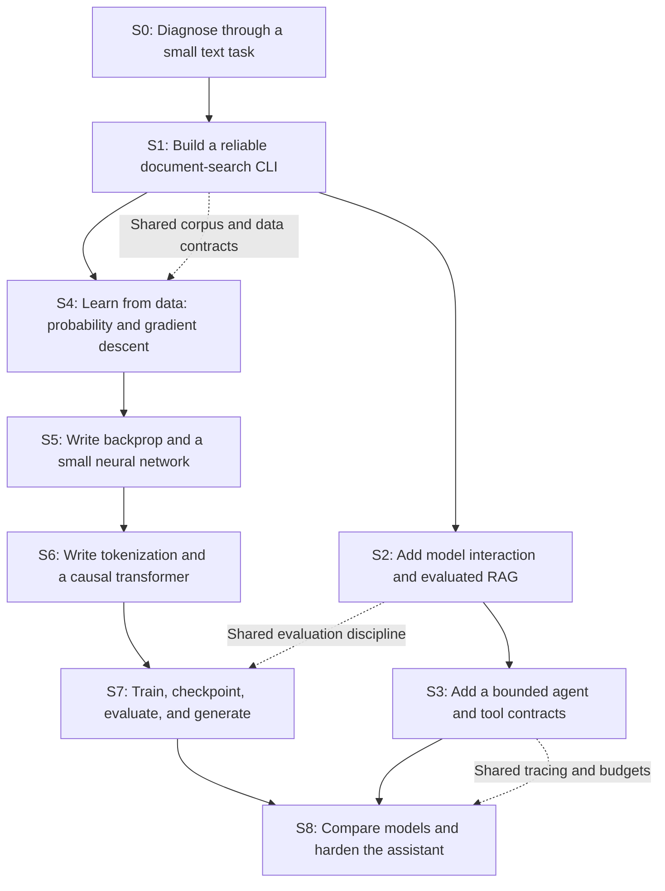

# Ahmed's project route: Python to AI engineering to a language model

Prepared 11 October 2026. Status: adopted project plan after the six-repository review. No learner completion is awarded by consolidation.

## The recommendation

Build one **AI Engineering Workbench**, with two connected components: **a grounded document assistant** and **a language-model laboratory**. Start with a small local text-search feature in the assistant. Use it to diagnose and develop Python skills. Add model interaction, RAG, and bounded agent tools; then build the learning algorithms and transformer internals in the laboratory. Return to the assistant for a measured integration and reliability capstone.

This creates a useful application early and keeps the long-term goal of implementing a model yourself visible. Each component has successive releases. Small experiments live inside this workbench rather than becoming a collection of unrelated tutorials.

Your clarification governs this plan:

- Study **two hours a day, five days a week: 10 hours/week**.
- Use **CPU as the baseline** on both desktop and laptop.
- Treat the desktop GTX 1050 Ti as an optional later experiment; its memory and current software compatibility have not been verified.
- Cover cumulative Python, software engineering, ML, deep learning, LLMs, **RAG and agents**, along with evaluation and system reliability.
- You write the learning code. The tutor explains, demonstrates small isolated examples, reviews attempts, and adjusts difficulty.

The application theme is a replaceable teaching vehicle. A document assistant offers frequent opportunities to practice common AI engineering patterns. You have requested cumulative skill coverage, rather than a specific business domain. Begin with a tiny, non-sensitive text corpus; choose the eventual domain after you have used the first release.

## Read the planning package

| Document | Purpose |
|---|---|
| [Learning method](01-LEARNING-METHOD.md) | Research basis, session structure, hints, review, and tutor conduct |
| [Project roadmap](02-PROJECT-ROADMAP.md) | Nine stages, concrete releases, prerequisites, effort, and exit gates |
| [Skills and mastery](03-SKILLS-AND-MASTERY.md) | Python diagnostic and cumulative AI engineering coverage |
| [First four weeks](04-FIRST-FOUR-WEEKS.md) | Twenty two-hour sessions, with adaptation rules |
| [Language-model build specification](05-LLM-BUILD-SPEC.md) | Exactly what you implement, compute limits, and proof of training |
| [Curriculum map and state](06-CURRICULUM-MAP-AND-STATE.md) | Verified local lesson links and interaction with the saved route |
| [Party discussion and decisions](07-ROUND-TABLE-AND-DECISIONS.md) | The disagreements behind the proposal and open choices |

The review of your five supplied project sources is a separate personal research annex, inside this project repository: [Project-source review](../research/PROJECT-SOURCE-REVIEW.md). This keeps external curriculum-repository references out of curriculum documentation.

## The cumulative route

The connections are deliberate. File handling becomes dataset ingestion. Counting words becomes probability estimation. A test suite becomes an evaluation harness. JSON persistence becomes checkpoint metadata. A prediction function becomes a model adapter. A bounded workflow becomes an agent loop. These are conceptual connections; share source code only after two actual consumers demonstrate that it fits.

## What 'a full LLM from scratch' means here

The required outcome is a **complete small decoder-only language-model system trained from random weights**. You implement its tokenizer, input/target construction, embeddings, attention, normalization, feed-forward blocks, next-token objective, training orchestration, checkpoint handling, and generation. You first implement backpropagation and a small network yourself, then use PyTorch's tensor and differentiation engine for practical transformer training while retaining your own model architecture.

A model at this learning scale is a small language model with the core architecture and lifecycle used in LLMs. The plan does not establish frontier-scale capability, reliable factual question answering, or strong instruction following. Those capabilities need separate data, compute, and evaluation. The name of the project must report its actual size and training evidence.

Training a base model, calling a hosted model, RAG, and fine-tuning are different achievements. Record them separately. The laboratory's tiny model does not automatically replace the assistant's more capable generation model. Its first useful integration may be a text-completion tool with a narrow task.

## Effort and calendar

These are planning estimates, not research findings or fixed deadlines. They include reading, coding, debugging, tests, and review; unattended long training time is additional elapsed time.

| Stage | Focused hours | Cumulative focused hours |
|---|---:|---:|
| S0: Diagnostic and project framing | 4–6 | 4–6 |
| S1: Intermediate Python through document search | 26–38 | 30–44 |
| S2: Model interaction and RAG | 36–52 | 66–96 |
| S3: Bounded agents and tools | 20–30 | 86–126 |
| S4: Math, classical learning, and text baselines | 50–70 | 136–196 |
| S5: Backpropagation and neural networks | 45–65 | 181–261 |
| S6: Tokenizer and transformer implementation | 60–85 | 241–346 |
| S7: Training and inference | 45–70 | 286–416 |
| S8: Integration and reliability | 20–30 | **306–446** |

Add a **20% planning reserve** for repair and retention: approximately **367–535 hours**, or **37–54 study weeks at 10 hours/week**, roughly **9–13 months of consistent study**. Time away adds calendar weeks. These estimates assume the bounded scopes in the roadmap; a full tensor-autograd engine, larger-scale pretraining, or additional framework projects change the estimate.

An initial evaluated RAG release is estimated at approximately **8–12 study weeks including reserve**. The first bounded agent release is approximately **11–16 weeks cumulatively**. A useful local search release comes earlier. Re-estimate after the diagnostic, first project release, first gradient implementation, and first transformer benchmark.

## The completion rule

Readiness permits advancement after execution, explanation and fresh independent transfer. Retained completion additionally requires delayed evidence; final route completion requires every retained stage. The four evidence forms are:

1. **Execution:** learner-authored code runs on the documented command and relevant tests pass.
2. **Explanation:** you trace the mechanism and explain a design choice in your own words.
3. **Transfer:** you solve a different fresh case on the tested candidate after the demonstrated execution/explanation, without AI hints or a supplied solution.
4. **Retention:** you perform a different fresh case at least 24 elapsed hours later without AI hints or a supplied solution; disclosed syntax documentation is allowed. Assisted revisit is practice.

Help is recorded, not punished. Reading documentation is allowed for implementation. Independent assessment uses a small fresh task with AI completion disabled; syntax references can remain available where the task tests design rather than memorization.

## Boundaries and next action

The public repository now owns this project plan. Its single route is `learning/route.json`; the event log is `learning/evidence.jsonl`, and `LEARNING.md` is a generated resume view. Run `uv run python scripts/learning_state.py status` before tutoring. The external curriculum is a reference shelf; its lesson resolver does not select this project's next task.

The first unresolved stage is S0. Preserve the learner's recorded configuration/model-call support needs and use an unfamiliar small document task to discover which Python skills need repair. Existing code is inherited or unpublished practice, not automatically learner competence. Future model and agent components are learner implementation work; this consolidation does not complete them.

See the [six-repository review and merge decisions](../review/CONSOLIDATION.md), [project contract](../../projects/grounded_support_assistant/README.md), and [state protocol](../../learning/PROTOCOL.md). The model laboratory is a component of the same workbench, sharing corpus provenance, evaluation discipline and the application adapter contract.
